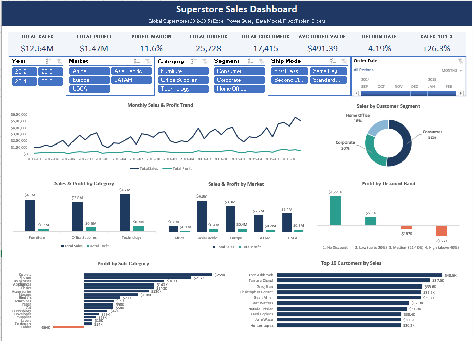
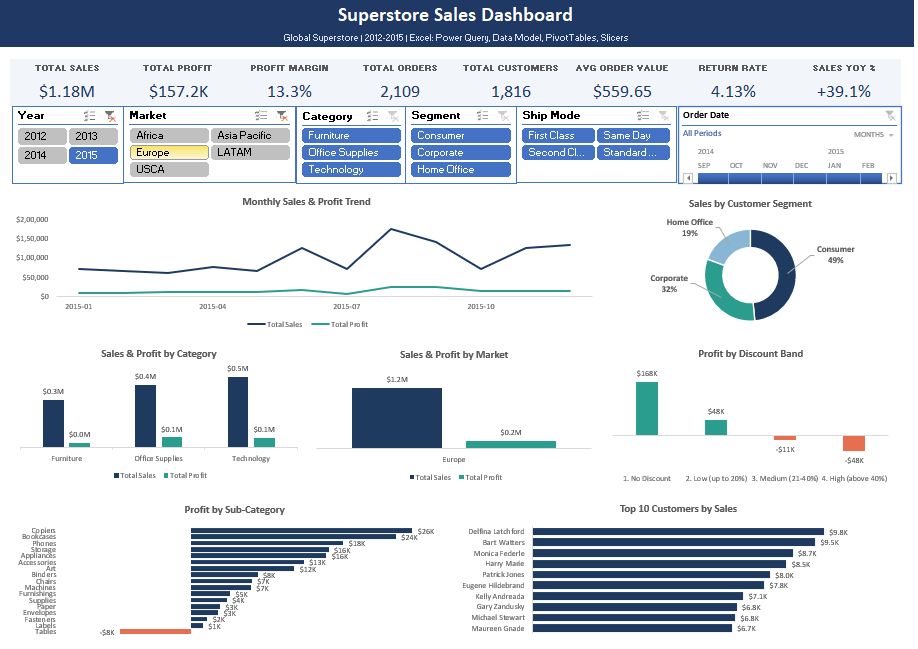

# Superstore Sales Dashboard (Excel)

An interactive sales and profit dashboard built **entirely in Excel** using Power Query, the Excel Data Model with DAX measures, PivotTables, PivotCharts, Slicers and a Timeline. One click on any slicer updates all 7 charts and 8 KPI cards.



---

## Business Questions
1. How are sales and profit trending over time, and what is the yearly growth?
2. Which categories, sub-categories and markets make money, and which lose it?
3. Do discounts help or hurt profit?
4. Who are the top customers, and how dependent is the business on them?
5. How do sales and profit change by segment, ship mode and period?

---

## Tools Used
| Tool | Used For |
|---|---|
| **Power Query** | Cleaning, merging 3 sheets, creating calculated columns |
| **Excel Data Model + DAX** | 11 reusable measures (Sales, Profit, Margin, YoY, Return Rate...) |
| **PivotTables / PivotCharts** | 8 pivots and 7 charts powering the dashboard |
| **Slicers + Timeline** | Year, Market, Category, Segment, Ship Mode, Order Date |
| **GETPIVOTDATA** | KPI cards that react to every filter |

---

## Dataset
Global Superstore sales data (`superstore_2016.xlsx`) with 3 sheets:

| Sheet | Rows | Description |
|---|---|---|
| Orders | 51,290 | Order lines: customer, product, sales, profit, discount, ship mode |
| Returns | 1,079 | Returned order IDs |
| People | 24 | Regional managers |

> The file name says 2016, but the order dates actually span **Jan 2012 to Dec 2015**.

---

## What I Did

### 1. Data Cleaning and Preparation (Power Query)
- Loaded `Orders`, `Returns` and `People` as Excel Tables
- Removed the **Postal Code** column (mostly empty)
- Merged **Returns** into Orders (Left Outer Join) to create `Return Status` (Yes / No)
- Merged **People** into Orders to bring in the regional manager
- Cleaned non-breaking spaces in manager names
- Labelled the Canada rows that have no matching region in People as **"Unassigned (Canada)"**
- Created calculated columns: `Year`, `Quarter`, `Month Number`, `Month`, `Year-Month`, `Ship Days`, `Profit Status`, `Discount Band`

### 2. Data Model and DAX Measures
| Measure | Logic |
|---|---|
| Total Sales | `SUM(Orders[Sales])` |
| Total Profit | `SUM(Orders[Profit])` |
| Profit Margin % | `DIVIDE([Total Profit],[Total Sales],0)` |
| Total Orders | `DISTINCTCOUNT(Orders[Order ID])` |
| Total Customers | `DISTINCTCOUNT(Orders[Customer ID])` |
| Total Quantity | `SUM(Orders[Quantity])` |
| Avg Order Value | `DIVIDE([Total Sales],[Total Orders],0)` |
| Avg Ship Days | `AVERAGE(Orders[Ship Days])` |
| Returned Orders | `CALCULATE(DISTINCTCOUNT(Orders[Order ID]), Orders[Return Status]="Yes")` |
| Return Rate % | `DIVIDE([Returned Orders],[Total Orders],0)` |
| Sales YoY % | Current year vs previous year using `VAR` / `CALCULATE` |

### 3. Dashboard
- **8 KPI cards:** Total Sales, Total Profit, Profit Margin, Total Orders, Total Customers, Avg Order Value, Return Rate, Sales YoY %
- **7 charts:** Monthly Sales & Profit Trend, Sales & Profit by Category, Profit by Sub-Category, Sales & Profit by Market, Sales by Segment, Profit by Discount Band, Top 10 Customers
- **6 interactive filters:** Year, Market, Category, Segment, Ship Mode slicers and an Order Date timeline, all connected to every pivot



---

## Key Insights

**Overall:** $12.64M sales, $1.47M profit (11.6% margin), 25,728 orders, 17,415 customers, average order value $491.39, return rate 4.19%.

1. **Strong growth.** Sales grew from $2.26M (2012) to $4.30M (2015), up 90%. Year-on-year growth was +18.5% (2013), +27.2% (2014) and +26.3% (2015).
2. **Discounts above 20% destroy profit.** Orders with no discount earned **$1.77M profit (25.3% margin)**. Medium discounts (21-40%) lost **$187K** and high discounts (above 40%) lost **$627K**. Together these 11,328 order lines (22% of all lines) lost **$815K**.
3. **Nearly 1 in 4 order lines loses money.** 12,544 lines (24.5%) are loss-making, with a combined loss of $921K.
4. **Technology is the strongest category.** It has the highest sales ($4.74M, 37.5%), the highest profit ($664K) and the best margin (14.0%). **Furniture** has similar sales ($4.11M) but only a **6.9% margin**.
5. **Tables is the only loss-making sub-category** (-$64K). Copiers ($259K), Phones ($217K) and Bookcases ($162K) are the top profit makers.
6. **Asia Pacific sells the most, Europe earns the most.** Asia Pacific has the highest sales ($4.04M) but a 10.0% margin. Europe has lower sales ($3.29M) but the highest profit ($450K) and margin (13.7%).
7. **Strong year-end seasonality.** November and December together bring about 25% of annual sales.
8. **Low customer concentration.** The top 10 customers make up only 2.7% of sales, so revenue does not depend on a few buyers.
9. **Customer mix.** Consumer 51.5%, Corporate 30.3%, Home Office 18.3% of sales, all with similar margins (11.5% to 12.0%).

### Recommendations
- **Cap discounts at 20%.** Anything above it loses money.
- **Review pricing or sourcing for Tables** and the Furniture category.
- **Improve Asia Pacific margins** to match Europe.
- **Stock up and plan campaigns before Nov-Dec.**
- Look into the **4.19% return rate** to find the products or regions behind it.

---

## How to Use the Dashboard
1. Open `Superstore_Sales_Dashboard.xlsx` in Excel (2019 or Microsoft 365 recommended).
2. Go to the **Dashboard** sheet.
3. Click any slicer button (Ctrl + click for multiple). All KPIs and charts update.
4. Drag on the **Order Date timeline** to pick a period.
5. Use the funnel icon with the cross at the top-right of a slicer to clear its filter.
6. The **Calc** sheet holds the PivotTables behind the dashboard.

---

## Repository Structure
```
excel-superstore-sales-dashboard/
|-- Superstore_Sales_Dashboard.xlsx    # Final interactive dashboard
|-- README.md
|-- data/
|   |-- superstore_2016.xlsx           # Raw data
|-- screenshots/
    |-- 01_dashboard_overview.png
    |-- 02_dashboard_filtered.png
    |-- 03_power_query_steps.png
    |-- 04_query_dependencies.png
```

---

## Data Notes
- Postal Code was removed because most values were empty.
- Some Canada orders have no matching regional manager in the People sheet. They are labelled **"Unassigned (Canada)"** (384 rows, 205 orders).
- Sales YoY % compares the selected year with the previous year. If only part of a year is picked on the timeline, it shows "n/a".

---

## Author
**Julfikar Ali**, Aspiring Data Analyst
- LinkedIn: [linkedin.com/in/julfikar1995](https://www.linkedin.com/in/julfikar1995)
- GitHub: [github.com/julfikar1995](https://github.com/julfikar1995)
- Email: zulfikar1944@gmail.com
